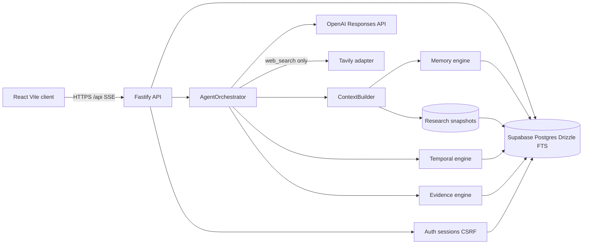

# Architecture

Minimi is a TypeScript **modular monolith**: one deployable Node process, clear internal modules, Supabase Postgres for persistence.

## System diagram

## Boundaries

| Module | Responsibility |
| --- | --- |
| `apps/web` | Chat UI, auth UX, SSE client, sanitized Markdown |
| `routes/*` | HTTP validation, authz via `getRequestUserId` |
| `agent/*` | Orchestrator, stream runner, citations, single tool |
| `memory/*` | Extraction, retrieval, privacy, consolidation |
| `search/*` + `services/research*` | Provider adapter + persistence |
| `temporal/*` | Date intent, claims, deterministic comparisons |
| `evidence/*` | Source/claim assessment, injection labeling |
| `auth/*` + `security/*` | Sessions, CSRF, headers, rate limits, audit |
| `evaluation/*` | Deterministic graders & reports |
| `performance/*` | Cache, gates, metrics, backup helpers |
| `packages/shared` | Shared response/event contracts |

## Request lifecycle

1. Authenticate (session cookie or `local_dev`)
2. Persist user message
3. Build context (messages + memory + research + dates)
4. OpenAI turn → optional `web_search`
5. Persist research → evidence → optional temporal compare
6. Validate citations → stream/persist answer
7. Optional memory ingestion

## Scaling note

The API is a long-running Node process (not Vercel serverless, because of long SSE streams). Postgres allows multiple instances; in-process caches/rate limits are per-instance.
